# 📚 2. LESSON 2 - JAVASCRIPT BASIC

## 📖 1. Variable Declaration
    - (Key) (variable name) = value;

    VD: var centerName: "Better Bytes Academy";

    let isLovePlayWright = true;

## 📖 2. Constant Declaration
    - (Key) (variable name) = value;

    VD: const slogan ="Học kỹ hiểu sâu";

## 📖 3. Condition
1. __Syntax:__

    - if (dkien){}

## 📖 4. Loop
- There are many types of loop:

    - for
    - for (of)
    - for (in)
    - while
    - do while

## 📖 5. Object
    const object = {
        name: "Hana",
        age: 29
    };

## 📖 6. Array
    const arr = [];

## 📖 7. Function

    function(){};
A function can contain arrays, objects, or executable statements, and it can return a value.
## 📖 5. Advanced Javascript

1. Variable Scope:

There are 3 types of scope in Javascipt:
- __Block scope:__ variables are declared inside a block {}:
    - var: not limited by block scope {}
    - let/const: limited to the block {}, in which they are declared. If access outside that block, they will cause a Reference Error: undefined
- Function scope: variables are declared in a function. var/let/const will cause a reference error undefined if access outside that block

- Global: variables are declared in ở free code , not inside block or function

2. __Break and continue:__

- __Break:__

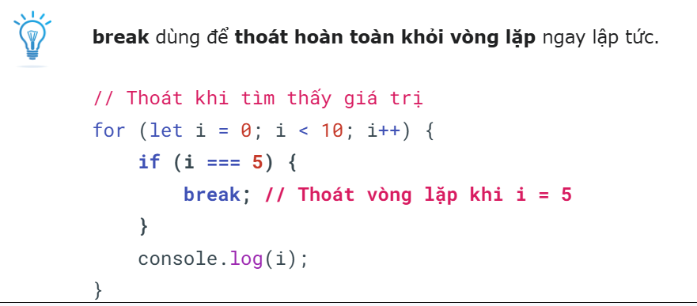
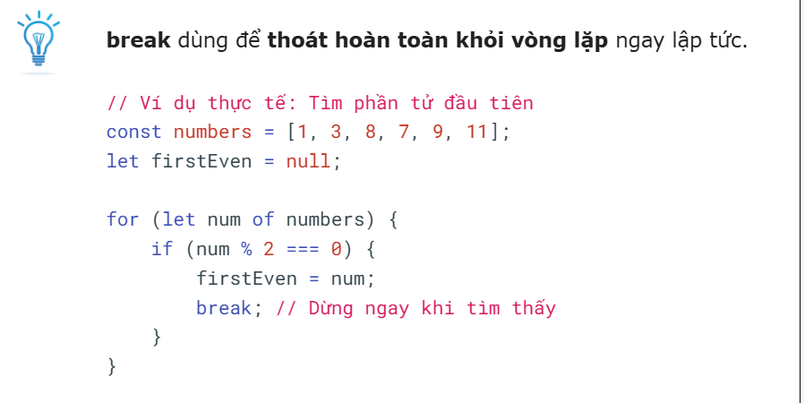

- __Continue:__

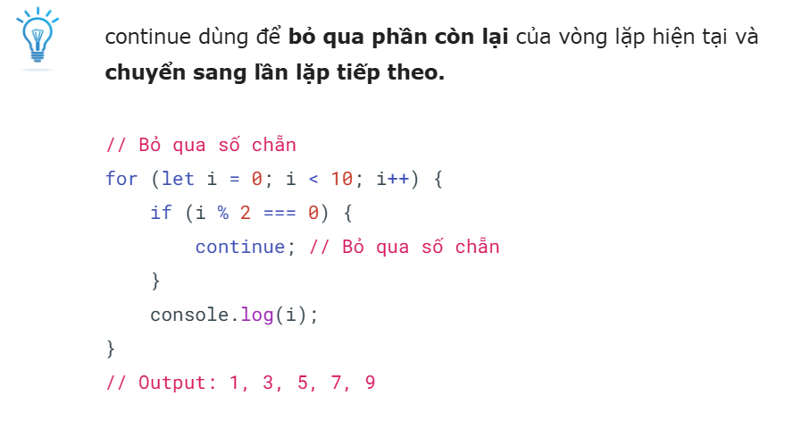
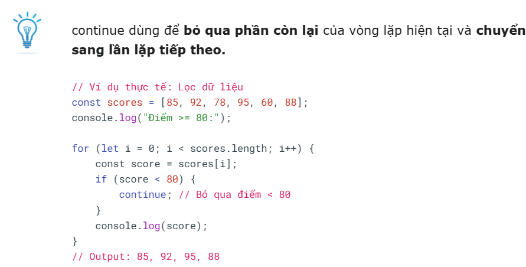

3. Advanced condition:

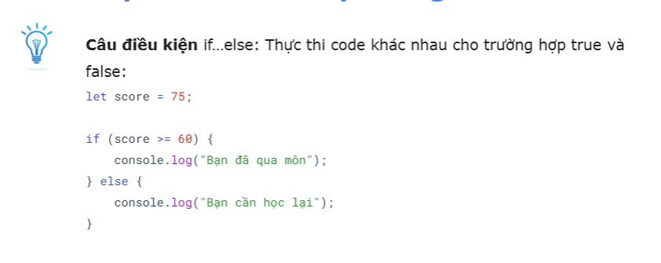
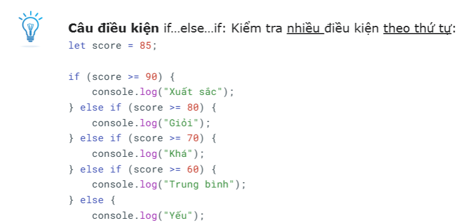
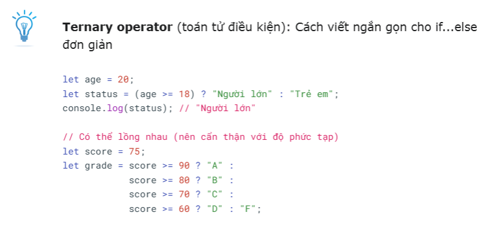

4. __Advanced loop:__
    - for...in: Used to iterate over the properties of an object. (iterate over: duyệt qua)
    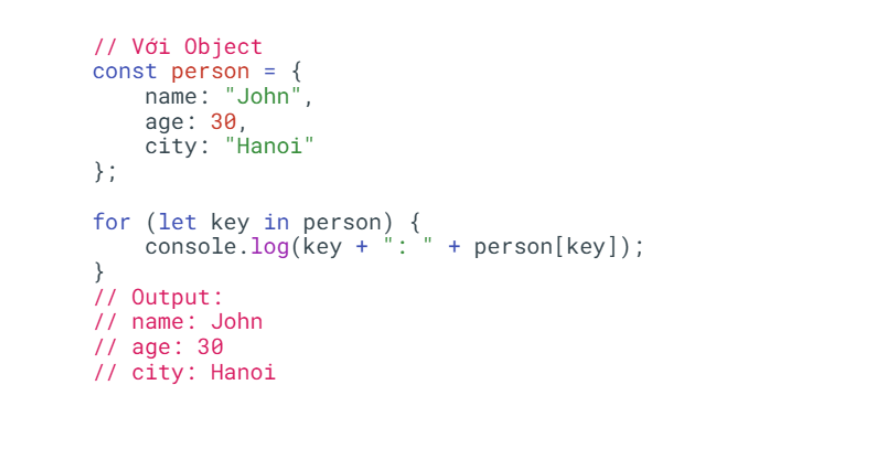

    - for...of: Used to iterate over the value of an array.
    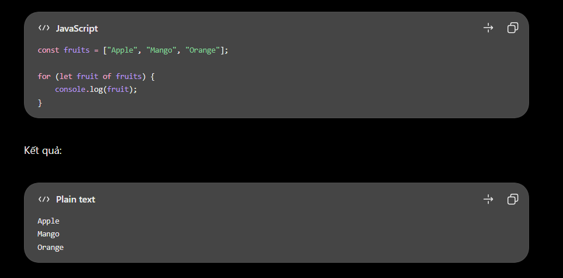

    - forEach(): Used to iterate over the elements of an array and execute a function for each element.
    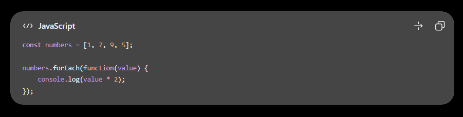
    

5. __Utils functions:__
- map():

- filer():

- find()

- reduce(): duyệt qua mảng và tích lũy các phần từ thành 1 giá trị duy nhất (số, chuỗi, object...) dựa trên hàm callback
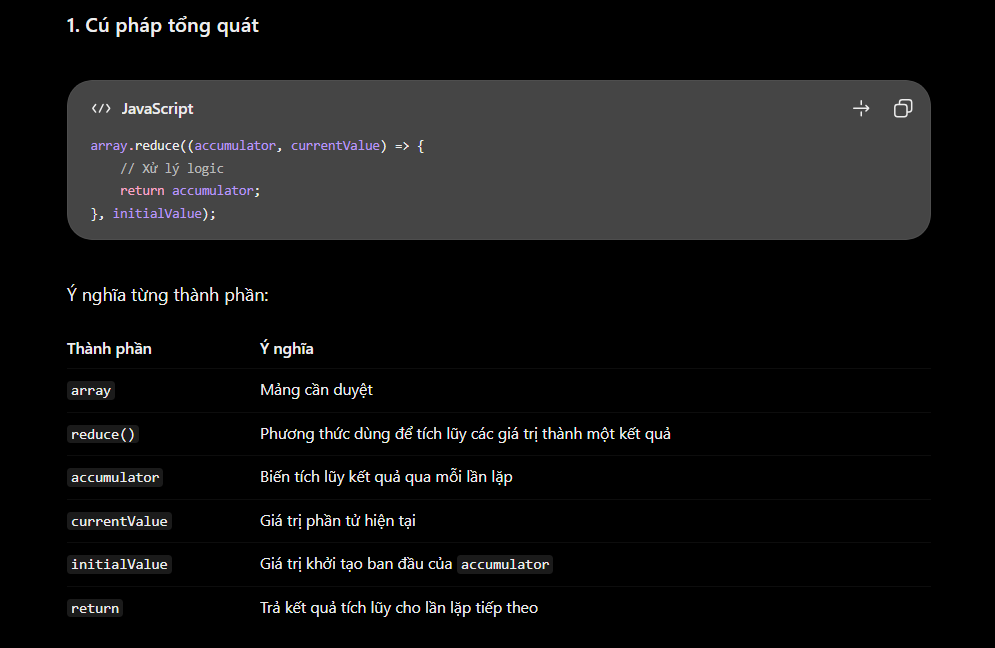

- some(): Kiểm tra xem có ít nhất 1 phần tử trong mảng thỏa điều kiện hay không. Trả về true/false
- every(): Kiểm tra xem all phần tử trong mảng thỏa điều kiện hay không. Trả về true/false

